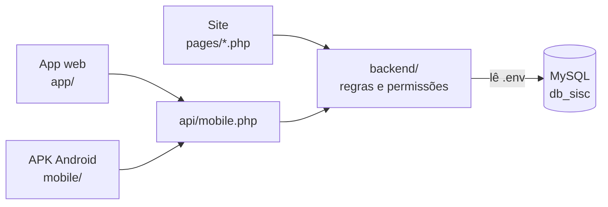

# CondoConnect

Sistema para condomínios: chamados de manutenção, conversas, reservas de espaços e comunicados.
Este guia leva você do zero até o sistema funcionando no servidor e no celular, um passo de cada vez.

> **Servidor de teste:** `http://2.24.65.149:8080/sisc-test`, pasta `/var/www/html/sisc-test`.
> Ele ainda usa **HTTP, sem criptografia**: a senha viaja aberta pela rede. Use somente contas
> de teste até o servidor ter HTTPS (seção 7).

**Sumário**

1. [O que é cada parte](#1-o-que-é-cada-parte)
2. [Colocar no servidor](#2-colocar-no-servidor)
3. [Criar uma conta de cada nível e entrar](#3-criar-uma-conta-de-cada-nível-e-entrar)
4. [Abrir no celular](#4-abrir-no-celular)
5. [Gerar um APK novo pelo GitHub Actions](#5-gerar-um-apk-novo-pelo-github-actions)
6. [Problemas comuns](#6-problemas-comuns)
7. [Voltar para HTTPS](#7-voltar-para-https)
8. [Para quem vai mexer no código](#8-para-quem-vai-mexer-no-código)

---

## 1. O que é cada parte

O CondoConnect tem **três formas de uso** e **um único banco de dados**:

| Parte | O que é | Onde fica no projeto | Endereço no servidor de teste |
|---|---|---|---|
| **Site** | Páginas abertas no navegador do computador ou do celular | `pages/`, `frontend/`, `index.php` | http://2.24.65.149:8080/sisc-test/ |
| **App web** | Versão para celular, aberta no navegador e instalável na tela inicial | `app/` | http://2.24.65.149:8080/sisc-test/app/ |
| **APK** | Aplicativo Android instalado no celular | `mobile/` | baixado em Releases (seção 4) |

Como elas se ligam ao banco:



- O **site** fala direto com o `backend/`.
- O **app web** e o **APK** não têm banco próprio: os dois chamam `api/mobile.php` no mesmo
  servidor do site. Por isso, uma conta criada no site entra no app e vice-versa.
- O `backend/` lê o endereço, o usuário e a senha do MySQL no arquivo **`.env`**, na raiz do site
  (`/var/www/html/sisc-test/.env`). Esse arquivo é criado pelo comando da seção 2.3 e **nunca**
  vai para o GitHub.

### Níveis de acesso

Cada conta tem um nível. Cada nível tem suas telas, e o **servidor confere a permissão em toda
operação**: mesmo que alguém altere o app, o servidor recusa o que aquele nível não pode fazer.

| Nível | O que vê e faz |
|---|---|
| **Morador** | Abre chamados, reserva espaços, lê comunicados, conversa com prestadores e com o síndico |
| **Prestador** | Vê os chamados disponíveis, aceita atendimentos e conversa com os moradores |
| **Síndico** | Administra **o próprio** condomínio: comunicados, reservas, chamados e informações |
| **Administrador** | Painel com todos os condomínios, lista de usuários e aprovação de síndicos |

---

## 2. Colocar no servidor

Todos os comandos desta seção são digitados **no servidor**, por SSH (no Windows, pelo PuTTY ou
pelo Terminal: `ssh usuario@2.24.65.149`). Linhas que começam com `sudo` pedem a senha do servidor.

### 2.1 Programas necessários (uma vez só)

O servidor de teste usa Debian com Apache. Instale o PHP, as extensões e o MySQL (MariaDB):

```bash
sudo apt update
sudo apt install apache2 libapache2-mod-php php php-mysql php-mbstring php-curl php-xml mariadb-server rsync git
sudo a2enmod rewrite
```

Confira se o PHP é 8.1 ou mais novo: `php -v`.

### 2.2 Enviar os arquivos para /var/www/html/sisc-test

**Pastas e arquivos que vão para o servidor:**

| Enviar | Não enviar |
|---|---|
| `.htaccess`, `.env.example`, `index.php`, `logout.php` | `mobile/` (código do APK) |
| `api/`, `app/`, `assets/`, `backend/`, `config/` | `tests/`, `docs/`, `node_modules/` |
| `frontend/`, `global/`, `includes/`, `pages/`, `style/` | `.git/`, `.github/`, `netlify/` |
| `tools/` (comandos de configuração, bloqueados na web) | nenhum `.env` do seu computador |

O jeito mais simples é baixar direto do GitHub no próprio servidor e copiar com o `rsync`, que
**não apaga** o `.env` nem as fotos e documentos já enviados pelos usuários:

```bash
cd /tmp
rm -rf condoconnect-app
git clone --depth 1 https://github.com/GUGULEOGOATGG/condoconnect-app.git
sudo mkdir -p /var/www/html/sisc-test
sudo rsync -a \
  --exclude=.git --exclude=.github --exclude=mobile --exclude=tests --exclude=docs \
  --exclude=node_modules --exclude=netlify --exclude=.env --exclude=/storage --exclude='*.docx' --exclude='*.asta' \
  /tmp/condoconnect-app/ /var/www/html/sisc-test/
```

> Prefere usar o mouse? No Windows, o programa **WinSCP** copia as mesmas pastas da tabela para
> `/var/www/html/sisc-test`. Não apague o `.env` nem a pasta `backend/storage` do servidor.

Dê ao Apache permissão de gravar as fotos, os anexos e os certificados:

```bash
sudo mkdir -p /var/www/html/sisc-test/backend/storage/uploads /var/www/html/sisc-test/backend/storage/perfil /var/www/html/sisc-test/backend/storage/certificados
sudo chown -R www-data:www-data /var/www/html/sisc-test/backend/storage
```

### 2.3 Criar o banco e o usuário do MySQL

Entre no MySQL como administrador:

```bash
sudo mysql
```

Cole os comandos abaixo, **trocando `troque-por-uma-senha-forte`** por uma senha só sua (anote-a),
e termine com `EXIT;`:

```sql
CREATE DATABASE db_sisc CHARACTER SET utf8mb4 COLLATE utf8mb4_unicode_ci;
CREATE USER 'condo'@'localhost' IDENTIFIED BY 'troque-por-uma-senha-forte';
GRANT ALL PRIVILEGES ON db_sisc.* TO 'condo'@'localhost';
FLUSH PRIVILEGES;
EXIT;
```

Não use o usuário `root` do MySQL no site: ele costuma entrar só pelo `sudo` e não funciona no PHP.

### 2.4 Ligar o site ao banco: `php tools/configurar-banco.php`

Este comando pergunta os dados do MySQL, testa a conexão, explica o que está errado quando falha
e, quando dá certo, grava o `.env`. Em um banco vazio, ele também importa as tabelas
(`db_sisc.sql`) e aplica a migração.

```bash
cd /var/www/html/sisc-test
sudo php tools/configurar-banco.php
```

Respostas para o servidor de teste (Enter aceita o valor entre colchetes):

| Pergunta | Resposta |
|---|---|
| Endereço do MySQL (DB_HOST) | `127.0.0.1` |
| Porta (DB_PORT) | `3306` |
| Nome do banco (DB_NAME) | `db_sisc` |
| Usuário do MySQL (DB_USER) | `condo` |
| Senha do MySQL (DB_PASS) | a senha da seção 2.3 (não aparece enquanto você digita) |
| Importar agora o arquivo db_sisc.sql neste banco? | `s` |
| Aplicar agora? (migração) | `s` |

O comando termina com **`BANCO_OK`**. Se aparecer `ERRO:`, a mensagem diz o que fazer (senha
errada, banco que não existe, usuário sem permissão, MySQL desligado); corrija e rode de novo.
Nada é gravado enquanto a conexão não funciona, e o `.env` anterior fica guardado como
`.env.bak-DATA`.

Depois, ajuste o endereço público usado nos e-mails:

```bash
sudo nano /var/www/html/sisc-test/.env
```

Troque a linha `APP_URL=http://localhost` por `APP_URL=http://2.24.65.149:8080`, salve
(Ctrl+O, Enter) e saia (Ctrl+X). Confira `APP_BASE_PATH=/sisc-test`.

Para testar a configuração de novo a qualquer momento, sem mudar nada:

```bash
sudo php tools/configurar-banco.php --testar
```

### 2.5 Migrações (atualizar o banco)

A migração acrescenta tabelas, colunas e dados de exemplo **sem apagar nada**. Ela já roda no
passo 2.4 em uma instalação nova. Rode de novo sempre que enviar uma versão nova do código:

```bash
cd /var/www/html/sisc-test
sudo mysqldump db_sisc > ~/backup-db_sisc-$(date +%F).sql   # cópia de segurança antes
sudo php backend/database/update_application.php
```

O resultado esperado termina com `APPLICATION_UPDATE_OK`.

### 2.6 Reiniciar o Apache

O `.htaccess` do projeto bloqueia o `.env`, o `backend/` e o `tools/` na web. Para ele valer,
o Apache precisa de `AllowOverride All` na pasta do site (modelo pronto em `deploy/apache.conf`).

```bash
sudo apachectl configtest      # deve responder "Syntax OK"
sudo systemctl restart apache2
```

Confira no navegador do computador:

| Endereço | Resultado esperado |
|---|---|
| http://2.24.65.149:8080/sisc-test/api/mobile.php?action=ping | `{"app":"CondoConnect","mobile_api":1}` |
| http://2.24.65.149:8080/sisc-test/api/mobile.php?action=health | `"ok":true` (banco e tabelas funcionando) |
| http://2.24.65.149:8080/sisc-test/.env | **403 Forbidden** (o arquivo com a senha não pode abrir) |
| http://2.24.65.149:8080/sisc-test/pages/login.php | Tela de login do site |

### 2.7 Atualizar para uma versão nova

Repita o `git clone` e o `rsync` da seção 2.2, rode a migração da seção 2.5 e reinicie o Apache
(2.6). O `.env` e os arquivos enviados pelos usuários são preservados.

---

## 3. Criar uma conta de cada nível e entrar

### 3.1 Com `php tools/criar-conta.php`

O comando cria a conta já liberada (e-mail confirmado). A senha é pedida no terminal e não
aparece no histórico. Toda conta pertence a um condomínio, digitado com o nome exato.

Veja os condomínios existentes:

```bash
cd /var/www/html/sisc-test
sudo php tools/criar-conta.php --listar-condominios
```

A instalação traz três condomínios **de demonstração** que já têm síndico. Para o seu, crie um
novo com `--criar-condominio` na primeira conta:

```bash
# Administrador (cria também o condomínio "Residencial Exemplo")
sudo php tools/criar-conta.php --nivel=admin --nome="Ana Administradora" --email=admin@exemplo.com.br \
  --telefone=11990000001 --condominio="Residencial Exemplo" --criar-condominio --cidade="São Paulo" --estado=SP

# Síndico (um por condomínio)
sudo php tools/criar-conta.php --nivel=sindico --nome="Sérgio Síndico" --email=sindico@exemplo.com.br \
  --telefone=11990000002 --condominio="Residencial Exemplo"

# Morador
sudo php tools/criar-conta.php --nivel=morador --nome="Maria Moradora" --email=morador@exemplo.com.br \
  --telefone=11990000003 --condominio="Residencial Exemplo" --unidade="Bloco A 101"

# Prestador
sudo php tools/criar-conta.php --nivel=prestador --nome="Paulo Prestador" --email=prestador@exemplo.com.br \
  --telefone=11990000004 --condominio="Residencial Exemplo"
```

Cada comando termina com `CONTA_CRIADA id=... nivel=...`. E-mail e telefone não podem se repetir.
Use senhas de pelo menos 8 caracteres.

Outras formas de criar contas:
- **Morador e prestador** também se cadastram sozinhos, pelo site ou pelo app ("Ainda não tenho
  uma conta"). Eles recebem um e-mail de confirmação (exige o Brevo configurado no `.env`).
- **Síndico** também pode se cadastrar pelo site, enviando o certificado; um administrador aprova
  em *Verificações*.
- **Administrador** só é criado pelo `criar-conta.php`.
- As contas de demonstração (`@demo.example.test`) ficam bloqueadas, a não ser que
  `APP_DEMO_LOGIN=1` esteja no `.env`.

### 3.2 Entrar

| Onde | Endereço |
|---|---|
| Site | http://2.24.65.149:8080/sisc-test/pages/login.php |
| App web | http://2.24.65.149:8080/sisc-test/app/ |
| APK | abra o app e toque em **Entrar na minha conta** |

Use o mesmo e-mail e a mesma senha em qualquer um. O app abre as telas do nível da conta:

| Nível | Abas no app |
|---|---|
| Morador | Início · Chamados · Conversas · Perfil |
| Prestador | Início · Atendimentos · Conversas · Perfil |
| Síndico | Início (gestão do condomínio) · Chamados · Conversas · Perfil |
| Administrador | Painel · Chamados · Usuários · Conversas · Perfil |

---

## 4. Abrir no celular

### 4.1 App web (qualquer celular)

1. No celular, abra o navegador e acesse **http://2.24.65.149:8080/sisc-test/app/**
2. Toque em **Testar conexão**. Deve aparecer "Tudo certo".
3. Entre com sua conta.
4. Para ter um ícone na tela inicial:
   - **Android (Chrome):** menu ⋮ → **Adicionar à tela inicial**.
   - **iPhone (Safari):** botão Compartilhar → **Adicionar à Tela de Início**.

### 4.2 APK (Android 7 ou mais novo, 64 bits)

**Link direto do APK:**
https://github.com/GUGULEOGOATGG/condoconnect-app/releases/download/apk-teste/CondoConnect-teste.apk

1. Abra o link no **celular**. O Chrome pode avisar que "este tipo de arquivo pode ser
   perigoso": toque em **Baixar assim mesmo**.
2. Toque na notificação do download (ou abra o app **Arquivos** → Downloads) e toque em
   `CondoConnect-teste.apk`.
3. **Liberar a instalação de apps desconhecidos** (só na primeira vez):
   - O Android mostra "Por segurança, seu telefone não tem permissão para instalar apps
     desconhecidos desta fonte". Toque em **Configurações**, ligue **Permitir desta fonte** e
     volte.
   - Se não aparecer: **Configurações → Apps → Acesso especial a apps → Instalar apps
     desconhecidos → Chrome** (ou **Arquivos**) → **Permitir desta fonte**. O caminho muda um
     pouco de marca para marca; procure "apps desconhecidos" na busca das Configurações.
   - Android 7: **Configurações → Segurança → Fontes desconhecidas**.
4. Toque em **Instalar**. Se o Play Protect avisar "App não verificado", toque em
   **Mais detalhes → Instalar assim mesmo**: o APK de teste não está na Play Store.
5. Abra o **CondoConnect**, toque em **Entrar na minha conta** e depois em **Testar conexão**.
   O endereço `http://2.24.65.149:8080/sisc-test` já vem preenchido. O aviso amarelo "Conexão de
   teste sem criptografia" é esperado enquanto o servidor estiver em HTTP.

Uma versão nova do APK instala por cima da anterior, sem perder o login. Se aparecer
"App não instalado", desinstale o CondoConnect antigo e instale de novo.

---

## 5. Gerar um APK novo pelo GitHub Actions

O APK é gerado no GitHub, sem precisar de Android Studio.

- **Automático:** todo envio para a branch `main` que mude a pasta `mobile/`, `api/mobile.php` ou
  o próprio workflow gera um APK novo.
- **Manual:**
  1. Abra https://github.com/GUGULEOGOATGG/condoconnect-app/actions
  2. Clique em **Android APK** (à esquerda) → **Run workflow** → branch `main` → **Run workflow**.
  3. Espere a bolinha ficar verde (de 15 a 30 minutos). Se ficar vermelha, clique nela para ver
     em que etapa parou.
  4. O APK novo substitui o arquivo da release **apk-teste**, em
     https://github.com/GUGULEOGOATGG/condoconnect-app/releases/tag/apk-teste. O link direto da
     seção 4.2 continua o mesmo. A release não é apagada.

O endereço do servidor que vem gravado no APK fica em `mobile/.env` e no passo "Compilar o APK" de
`.github/workflows/android-apk.yml`. Os dois precisam ser iguais (um teste confere isso).

---

## 6. Problemas comuns

O botão **Testar conexão** (na tela de login do APK e do app web) mostra em que etapa a conexão
para: endereço → servidor → API do aplicativo → banco de dados → tabelas. Comece por ele.

| Mensagem | Causa | Como corrigir |
|---|---|---|
| **O servidor demorou a responder. Tente novamente.** (APK 2.0.0, antigo) | O app esperou 20 s sem resposta. Duas causas possíveis: **(a)** o celular não alcança `2.24.65.149:8080` (rede que bloqueia a porta 8080, servidor desligado, firewall); **(b)** o PHP ficava até ~21 s esperando um MySQL inalcançável antes de responder. | Instale o APK novo (seção 4.2): ele diz qual das causas é. Para **(a)**, abra no navegador do celular http://2.24.65.149:8080/sisc-test/api/mobile.php?action=ping; se não abrir, troque de rede (Wi-Fi ↔ dados) e confira o firewall do servidor (`sudo ufw status`: a porta 8080 precisa estar liberada). Para **(b)**, envie o código novo ao servidor (2.7): agora o PHP desiste do MySQL em 5 s e responde "Banco indisponível". |
| **Servidor fora do alcance: ... não respondeu em 20 segundos** | O celular não recebeu nenhuma resposta do servidor. | Mesmo teste do ping no navegador do celular. Confira a internet, o endereço e se o Apache está ligado (`sudo systemctl status apache2`). |
| **Servidor fora do alcance: não foi possível abrir conexão com ...** | Sem internet, endereço errado ou servidor recusando a porta. | Confira o endereço (com `:8080` e `/sisc-test`). No servidor: `sudo systemctl restart apache2`. |
| **O servidor respondeu com erro (404): a API do aplicativo não existe nesse endereço** | O endereço está sem a subpasta ou o servidor está sem `api/mobile.php`. | Use `http://2.24.65.149:8080/sisc-test`. Envie as pastas `api/`, `app/` e `backend/` (seção 2.2). |
| **O servidor não tem a verificação de saúde (versão antiga da API)** | O servidor tem uma versão antiga de `api/mobile.php`. | Envie a versão atual (seção 2.7). |
| **O servidor respondeu com erro (500)** | Erro dentro do PHP. | Veja o motivo em `sudo tail -n 50 /var/log/apache2/error.log` e avise quem cuida do código. |
| **Banco indisponível: o servidor está no ar, mas não conseguiu acessar o MySQL** · no site: *O banco de dados está indisponível no momento* | `.env` com dados errados, MySQL desligado ou usuário sem permissão. | `sudo php tools/configurar-banco.php --testar` mostra a causa. MySQL desligado: `sudo systemctl start mariadb`. Dados errados: `sudo php tools/configurar-banco.php`. |
| **Banco indisponível: o .env do servidor não tem a configuração do MySQL** | Falta o `.env` ou as linhas `DB_...`. | `sudo php tools/configurar-banco.php` (seção 2.4). |
| **Banco desatualizado: ... faltam tabelas ou colunas** · no site: *O banco de dados precisa ser atualizado* | Código novo com banco antigo. | Rode a migração (seção 2.5). |
| **E-mail ou senha inválidos.** | Senha errada, conta inexistente, conta bloqueada ou conta de demonstração. | Confira a senha. Crie a conta com `criar-conta.php` (seção 3). |
| **Sua sessão expirou. Entre novamente.** | O acesso vale 7 dias, ou a conta saiu em outro aparelho. | Entre de novo. |
| **Confirme seu e-mail para acessar...** | Conta criada pelo cadastro público ainda sem confirmação. | Clique no link do e-mail. Contas do `criar-conta.php` já vêm confirmadas. |
| **Neste APK de teste, HTTP só é liberado para 2.24.65.149** | Foi digitado outro endereço com `http://`. | Use `http://2.24.65.149:8080/sisc-test` ou um endereço `https://`. |
| **Use um endereço HTTPS, sem senha, parâmetros ou fragmentos.** | Endereço com `?`, `#`, usuário/senha ou sem `https://`. | Digite só o endereço do site, ex.: `http://2.24.65.149:8080/sisc-test`. |
| **Formulário expirado. Volte à página, atualize e tente novamente.** (site) | A página ficou aberta mais de 2 horas, ou os cookies estão bloqueados. | Atualize a página (F5) e envie de novo. |
| **Not Found** no navegador ao abrir o site | Arquivos fora de `/var/www/html/sisc-test` ou endereço sem `/sisc-test`. | Confira com `ls /var/www/html/sisc-test/pages/login.php`. |
| `.env` abre no navegador em vez de dar 403 | O Apache está ignorando o `.htaccess`. | Coloque `AllowOverride All` (modelo em `deploy/apache.conf`), rode `sudo a2enmod rewrite` e reinicie o Apache. **Troque a senha do MySQL**, pois ela ficou exposta. |
| `CONTA_NAO_CRIADA: Selecione um condomínio cadastrado.` | Nome do condomínio diferente do cadastrado. | `--listar-condominios` mostra os nomes; ou acrescente `--criar-condominio`. |
| `CONTA_NAO_CRIADA: Este condomínio já possui um síndico responsável.` | Cada condomínio tem um síndico só. | Use outro condomínio ou crie um com `--criar-condominio`. |
| **App não instalado** (Android) | Já existe um CondoConnect assinado de outro jeito. | Desinstale o antigo e instale de novo. |

---

## 7. Voltar para HTTPS

Quando o servidor tiver certificado, retire a liberação de HTTP. Assim a senha passa a viajar
criptografada.

1. **Certificado no servidor.** O jeito mais comum exige um domínio apontando para o servidor
   (ex.: `condo.seudominio.com.br`):
   ```bash
   sudo apt install certbot python3-certbot-apache
   sudo certbot --apache -d condo.seudominio.com.br
   ```
   Confira que `https://condo.seudominio.com.br/sisc-test/api/mobile.php?action=health` responde
   `"ok":true`.
2. **`.env` do servidor:** `APP_URL=https://condo.seudominio.com.br`. Use `APP_HTTPS=1` somente
   se um proxy recebe o HTTPS e repassa ao Apache em HTTP.
3. **`mobile/.env`:** troque para `EXPO_PUBLIC_API_BASE_URL=https://condo.seudominio.com.br/sisc-test`
   e **apague** a linha `EXPO_PUBLIC_ALLOW_HTTP=1`.
4. **Apague a pasta `mobile/android/app/src/release/`** (ela contém o `AndroidManifest.xml` e o
   `res/xml/network_security_config.xml`, que liberam HTTP para 2.24.65.149).
5. **`mobile/src/domain.ts`:** deixe `export const insecureHttpHosts = [];`.
6. **`.github/workflows/android-apk.yml`**, passo "Compilar o APK": troque
   `EXPO_PUBLIC_API_BASE_URL` pelo endereço `https://` e apague a linha
   `EXPO_PUBLIC_ALLOW_HTTP: '1'`. Atualize também o texto das notas da release no passo
   "Publicar o APK em Releases".
7. Envie para a `main`. O GitHub Actions gera o APK novo (seção 5); os testes conferem que nenhum
   endereço HTTP ficou liberado.
8. Nos celulares, instale o APK novo. Quem tinha salvo o endereço `http://` vai ver um aviso:
   toque em **Alterar o endereço do condomínio** e informe o `https://`.
9. Opcional: redirecione o HTTP para o HTTPS no Apache (o certbot oferece isso).

---

## 8. Para quem vai mexer no código

```bash
npm ci --ignore-scripts && npm test && npm run lint    # site e app web (o lint precisa de PHP)
cd mobile && npm ci && npm test && npm run typecheck   # APK
phpunit                                                # PHP, com um MySQL/MariaDB de teste
```

O `phpunit` usa somente um banco chamado `sisc_test` (variáveis `TEST_DB_HOST`, `TEST_DB_PORT`,
`TEST_DB_NAME`, `TEST_DB_USER`, `TEST_DB_PASS`) e apaga os dados dele: nunca aponte para o banco
real. O workflow **Build** roda tudo isso no GitHub com um MariaDB próprio.

Detalhes técnicos (variáveis do `.env`, Brevo, Mercado Pago, migrações antigas, cobertura de
testes): [docs/referencia-tecnica.md](docs/referencia-tecnica.md). Mais sobre o APK:
[mobile/README.md](mobile/README.md).
